# The game

IPAD · IPADOS 26 · IN TESTING

Something is making the storms. Every few minutes a front rolls across
the world, and the colonies that came before you did not survive it.
You land with a ship, a small crew and a debt to the Company that sent
you. Stormward is about what you build, who you trust with it, and
finding out who runs the Engine behind the weather.

It plays in three loops. You build a site that makes things. You
defend it when the storm brings raiders. You move what you make
across the world to pay your way. Each loop feeds the others, and each
one teaches a real idea along the way: power and emissions, debt and
interest, supply and price.

Open any section below for the detail.

## Build

You walk each site with one thumb and lay it out with the other. A
drill sits on an ore outcrop, belts carry the ore, and machines turn it
into what you need next.

<figure class="shot">
  <a class="zoom" href="assets/shots/full/site.jpg">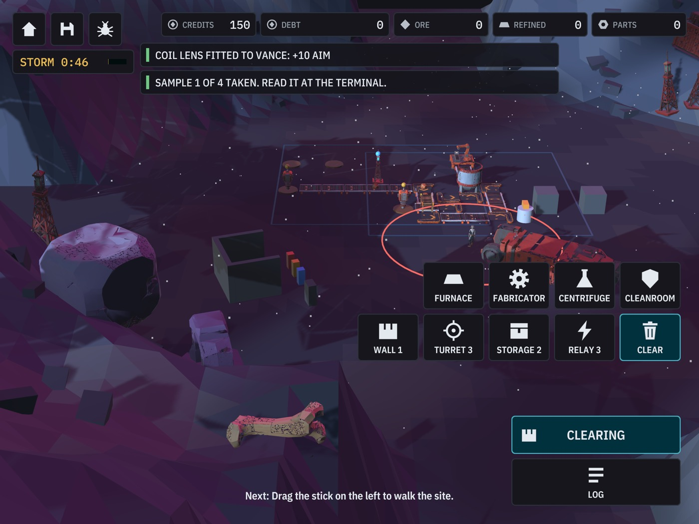</a>
  <figcaption>A site: machines, the ship, and landmarks on the slope.</figcaption>
</figure>

The factory

- Drills cut ore by hardness: soft ore takes any drill, hard ore needs
  a better one, and every node runs dry in the end.
- Belts run in straight lines and corners, and a bridge carries one
  belt over another.
- A refiner, a furnace, an assembler and a fabricator each run by
  recipe: what goes in, what comes out, how long it takes.
- Tap any machine to see what it is doing and why it stopped.
- Drills take modules, and modules made at a powered fabricator change
  how they work.

<figure class="shot">
  <a class="zoom" href="assets/shots/full/factory.jpg">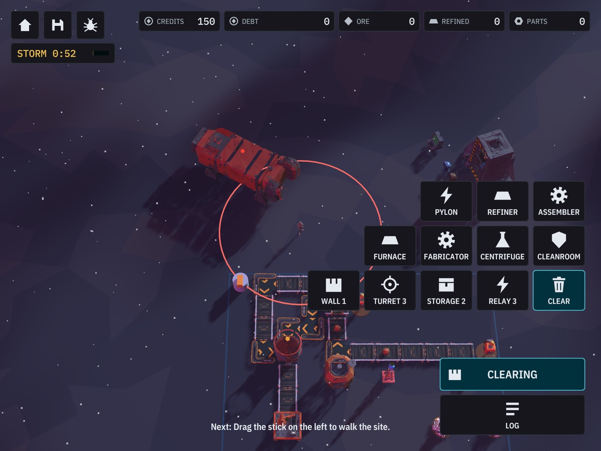</a>
  <figcaption>The build keys, in groups, beside a belt line.</figcaption>
</figure>

Power, and what it costs the air

Nothing runs without power, and every source has a price.

- A generator is cheap and dirty. A solar array and a wind turbine are
  clean but cost more parts.
- A fission reactor burns fuel rods you enrich from mined uranium. The
  spent fuel has to go somewhere: seal it into casks, or the reactor
  stops.
- A fusion reactor burns helium-3 mined on ash fields.
- Every tonne of carbon you emit joins the world total, next to
  everyone else's. On the fullest DEPTH setting the world warms as it
  climbs.

Research

A lab in power reach opens new tiers of machines and modules. Modules
carry tags, and the right pair or triple of tags on one frame makes a
combo. The iPad's own on-device model gives each kit a name.

## Defend

When the storm comes, the fight is turn by turn on the ground you
built.

<figure class="shot">
  <a class="zoom" href="assets/shots/full/fight.jpg">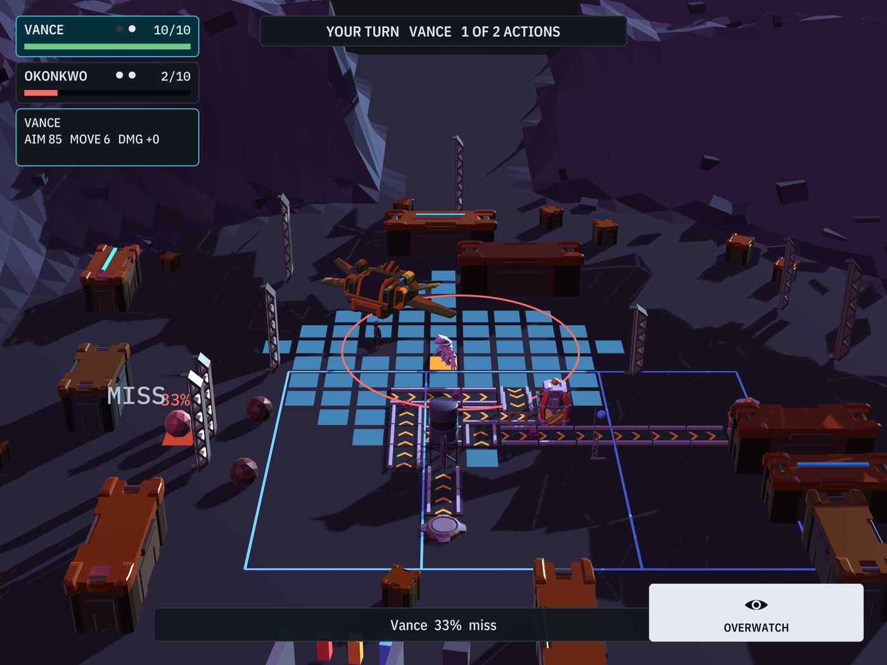</a>
  <figcaption>Blue tiles show the move. Every shot shows its odds.</figcaption>
</figure>

Turn fights

Action points, cover, flanking, overwatch and line of sight. Every shot
shows its odds before you take it. Two taps to move or shoot. Lose the
whole squad, and the game tells you what happened, the rule behind it,
and where to read more.

The outpost and the storm

Walls, turrets and storage go up around the ship. The command module
starts the base and shelters the crew; any building linked to it
shelters them too. A clock counts down to the next front, and SETTINGS
lets you change how often it comes and how hard it hits.

<figure class="shot">
  <a class="zoom" href="assets/shots/full/outpost.jpg">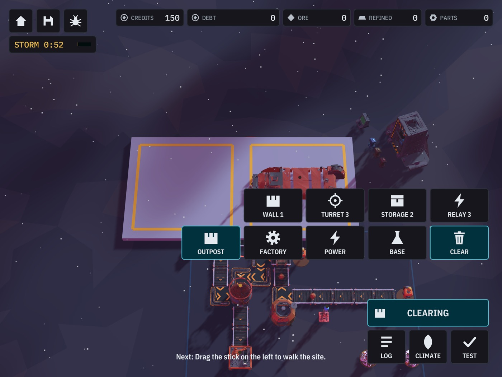</a>
  <figcaption>Placing an outpost while the storm clock runs.</figcaption>
</figure>

Crew

Hires have roles, quirks, levels and pay. Drag a portrait onto the
refiner to put them to work. Payroll comes due every payday whether the
factory made money or not.

<figure class="shot">
  <a class="zoom" href="assets/shots/full/crew.jpg">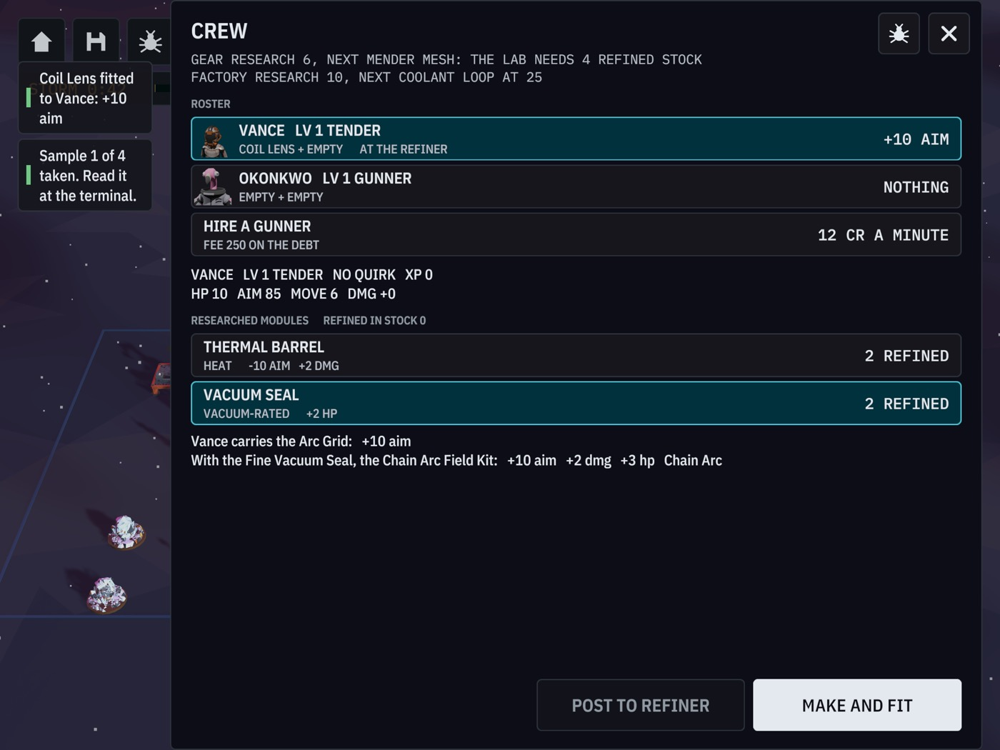</a>
  <figcaption>The crew, their roles and pay, and the modules research opened.</figcaption>
</figure>

## Trade

What you make is worth more somewhere else.

<figure class="shot">
  <a class="zoom" href="assets/shots/full/trade.jpg">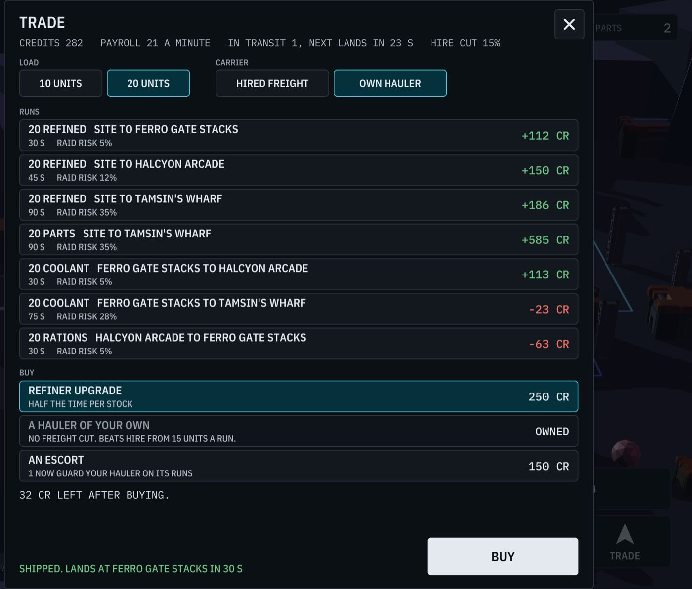</a>
  <figcaption>Every run shows its raid risk beside what it earns.</figcaption>
</figure>

Colonies, freight and raiders

Three colonies buy and sell at prices that move. Hire freight at first;
your own ship beats hired freight once the trade grows. Raiders hunt
the long routes, and escorts fight them off. Every quote shows the risk
beside the revenue.

Polities, tariffs and customs

Each colony belongs to a polity: a federal republic, a one-party
state, a social democracy and others. A polity charges a tariff on
cargo you land there, and the polity you belong to takes income tax.
The first colony you land a cargo at makes you a member.

At customs you DECLARE or EVADE. EVADE skips the tariff, and the gain
lands at once. But the record is always found, within a few pay
periods. The fine is bigger than what you saved, and that polity's
markets pay you less from then on. OWN UP before they find it: it
costs less, and you keep your standing.

Some polities also charge a carbon price on every tonne you emit.

Polities show from the STANDARD depth up. The carbon price needs FULL.

Debt

You start owing the Company. Interest grows the debt each payday, and
while you owe, a share of every sale pays it down. Before a payday the
game may ask you to guess whether your credits will cover the crew,
then shows you whether you were right.

## Explore

A world of 256 tiles

The world is a 16 by 16 map under fog. Walk off an edge to the next
tile, or fly the ship to any tile you have seen. A base you leave
behind keeps running, relays and freight routes let bases share stock,
and the world keeps going while the app is closed.

<figure class="shot">
  <a class="zoom" href="assets/shots/full/map.jpg">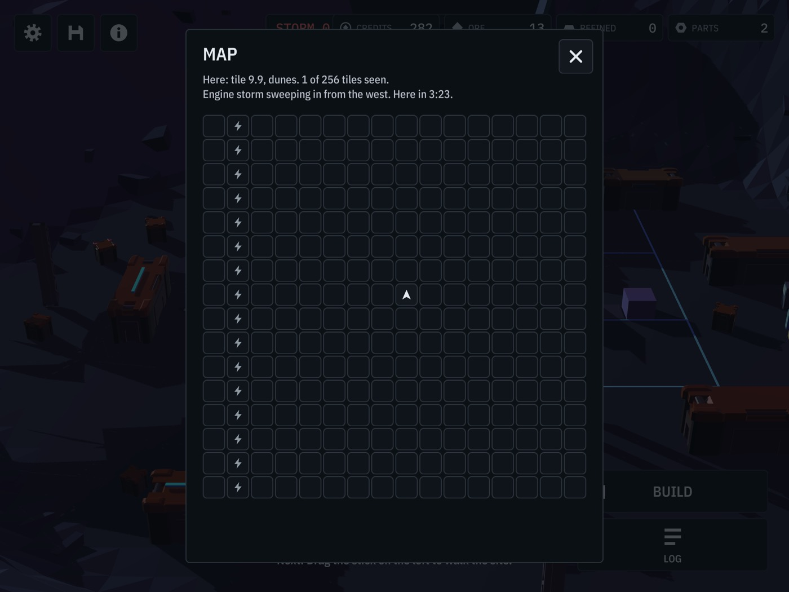</a>
  <figcaption>The map under fog, with a storm front coming in from the west.</figcaption>
</figure>

<svg class="defs" width="0" height="0" aria-hidden="true" focusable="false">
  <symbol id="m-dot" viewBox="0 0 1 1"><circle cx=".5" cy=".5" r=".4"/></symbol>
  <symbol id="m-ship" viewBox="0 0 1 1"><polygon points=".5,.05 .88,.92 .5,.7 .12,.92"/></symbol>
  <symbol id="m-bolt" viewBox="0 0 1 1"><polygon points=".6,.03 .18,.56 .46,.56 .38,.97 .82,.42 .54,.42"/></symbol>
  <symbol id="m-vault" viewBox="0 0 1 1"><path fill-rule="evenodd" d="M.12 .12H.88V.88H.12Z M.45 .529A.12 .12 0 1 1 .55 .529V.72H.45Z"/></symbol>
  <symbol id="m-engine" viewBox="0 0 1 1"><circle cx=".5" cy=".5" r=".36" fill="none" stroke="currentColor" stroke-width=".09"/><circle cx=".5" cy=".5" r=".09"/><rect x=".46" y=".02" width=".08" height=".2"/><rect x=".46" y=".78" width=".08" height=".2"/><rect x=".02" y=".46" width=".2" height=".08"/><rect x=".78" y=".46" width=".2" height=".08"/></symbol>
  <symbol id="m-crew" viewBox="0 0 1 1"><circle cx=".5" cy=".28" r=".18"/><polygon points=".14,.92 .18,.64 .34,.52 .66,.52 .82,.64 .86,.92"/></symbol>
  <symbol id="m-find" viewBox="0 0 1 1"><path fill-rule="evenodd" d="M.5 .04L.78 .3L.7 .96L.3 .96L.22 .3Z M.4 .4a.1 .1 0 1 0 .2 0a.1 .1 0 1 0 -.2 0Z"/></symbol>
</svg>

<b>Map legend.</b> The line at the top names the tile and its
ground (basin, dunes, frost or ash), counts the tiles you have seen,
and says when the next storm front arrives and from which side.

<b>The whole world</b>, one square a tile. Each tile shows one
mark; the storm's bolt covers the others.

<ul>
  <li>Fog: a tile you have not seen. It takes no tap.</li>
  <li><svg aria-hidden="true"><use href="#m-dot"/></svg>A tile you have seen. Tap it to pick it.</li>
  <li><svg aria-hidden="true"><use href="#m-dot"/></svg>The tile you picked. FLY takes the ship there, WALK the squad, and ROUTE buys a freight route to it.</li>
  <li><svg aria-hidden="true"><use href="#m-ship"/></svg>Here: the tile you are on.</li>
  <li><svg aria-hidden="true"><use href="#m-vault"/></svg>A vault.</li>
  <li><svg aria-hidden="true"><use href="#m-bolt"/></svg>The Engine storm: the tiles its front covers now. It shows over fog too.</li>
  <li><svg aria-hidden="true"><use href="#m-engine"/></svg>The Storm Engine. It appears later.</li>
</ul>

<b>Zoomed in</b>, with a pinch or the + and &minus; keys, each
tile shows its ground and what is known on it.

<ul>
  <li>Fog: ground you have not seen.</li>
  <li>Ground on a tile you have seen.</li>
  <li>Ground your squad has swept with the radar as it walked.</li>
  <li><svg aria-hidden="true"><use href="#m-crew"/></svg>Your squad.</li>
  <li><svg class="small" aria-hidden="true"><use href="#m-dot"/></svg>An ore deposit.</li>
  <li><svg class="small" aria-hidden="true"><use href="#m-dot"/></svg>A hostile.</li>
  <li><svg aria-hidden="true"><use href="#m-vault"/></svg>A vault.</li>
  <li><svg aria-hidden="true"><use href="#m-ship"/></svg>The ship. On other tiles it marks the tile you started on.</li>
  <li><svg aria-hidden="true"><use href="#m-find"/></svg>A find to pick up.</li>
</ul>

Deposits, hostiles and finds show only on ground swept on the tile
you are on.
The radar disc in the top left uses the same marks: dots for
deposits and hostiles, small icons for the ship, a vault and a
find.

Vaults, and the ending

Each vault has a terminal to read and a door to open. Behind the doors
are chapters of the story and samples that show why the earlier
colonies died. Analyse them all, and the Engine appears on the map.
Reach it and you can stop it.

<figure class="shot">
  <a class="zoom" href="assets/shots/full/terminal.jpg">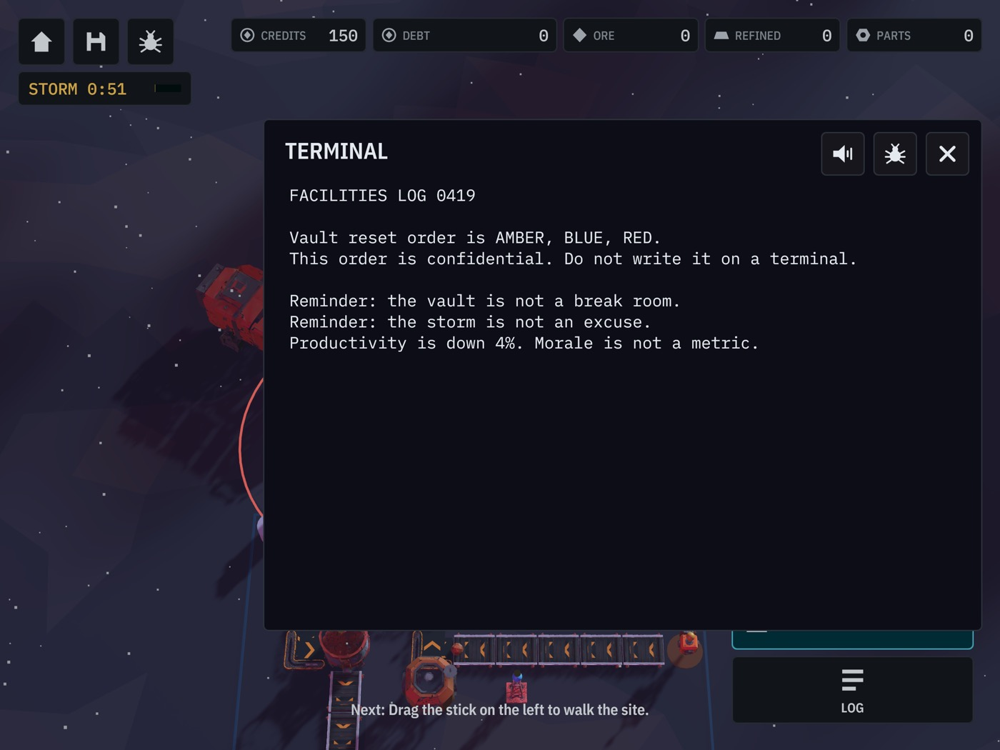</a>
  <figcaption>A vault terminal. Read it before you try the door.</figcaption>
</figure>

What you learn

A short test of twelve questions at the start and again after the last
vault shows what changed. It is optional and earns nothing. The
numbers in it are the game's own: furnace rates, interest, emissions.

## Yours to set up

<figure class="shot">
  <a class="zoom" href="assets/shots/full/start.jpg">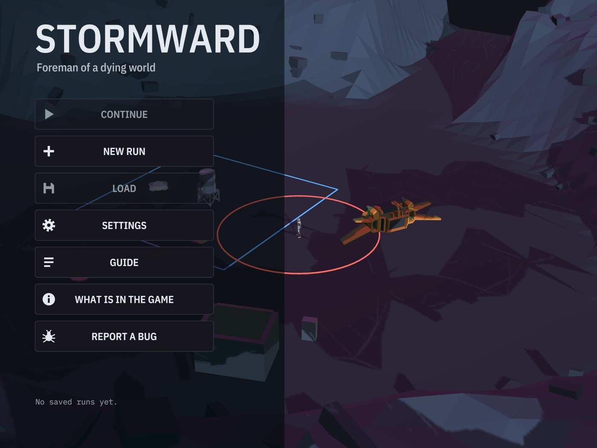</a>
  <figcaption>The start page. The bug key is on every screen too.</figcaption>
</figure>

Settings and access

- Two looks: sci-fi and megacity. Neither changes a rule.
- Text up to half as big again.
- READ ALOUD reads long texts with the iPad's own voice, offline.
- DEPTH sets how much of the world's systems you manage.
- Ten save slots with pictures, a safety save, and no account.
- A bug key on every screen opens Mail with a picture attached.

## The parts

These models give the default look its machines, creatures and land.
Each one started as a single picture.

### Machines

<ul class="parts">
  <li><a class="zoom" href="assets/parts/full/drill.jpg">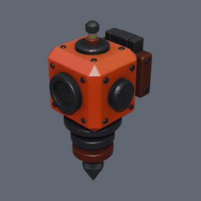</a><b>Drill</b>cuts ore from a node</li>
  <li><a class="zoom" href="assets/parts/full/refiner.jpg">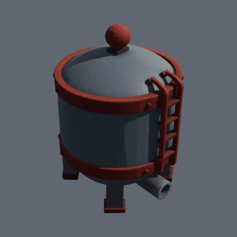</a><b>Refiner</b>turns ore into stock</li>
  <li><a class="zoom" href="assets/parts/full/assembler.jpg">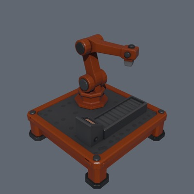</a><b>Assembler</b>builds parts by recipe</li>
  <li><a class="zoom" href="assets/parts/full/pylon.jpg">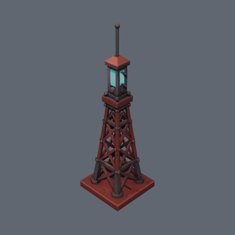</a><b>Pylon</b>carries power</li>
  <li><a class="zoom" href="assets/parts/full/relay.jpg">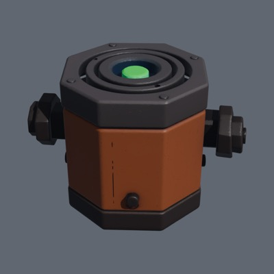</a><b>Relay</b>lets bases share stock</li>
  <li><a class="zoom" href="assets/parts/full/storage.jpg">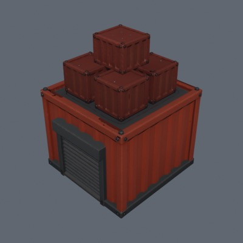</a><b>Storage</b>holds what you make</li>
  <li><a class="zoom" href="assets/parts/full/belt.jpg">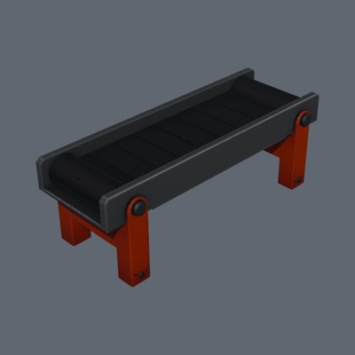</a><b>Belt</b>carries ore and stock</li>
  <li><a class="zoom" href="assets/parts/full/belt-corner.jpg">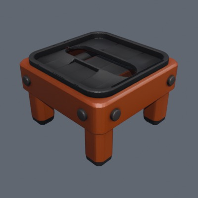</a><b>Belt corner</b>turns a belt</li>
  <li><a class="zoom" href="assets/parts/full/belt-bridge.jpg">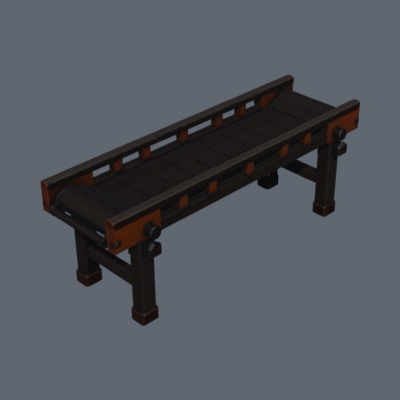</a><b>Belt bridge</b>lifts one belt over another</li>
</ul>

### What the belts carry

<ul class="parts">
  <li><a class="zoom" href="assets/parts/full/ore-node.jpg">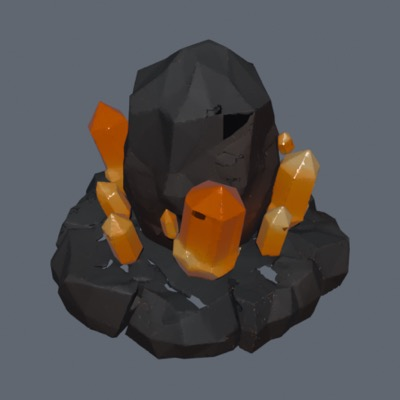</a><b>Ore node</b>runs dry in the end</li>
  <li><a class="zoom" href="assets/parts/full/ore.jpg">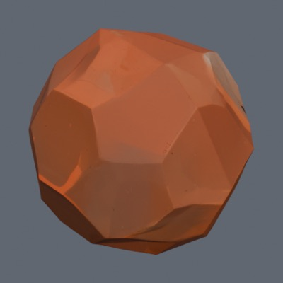</a><b>Ore</b>straight from the drill</li>
  <li><a class="zoom" href="assets/parts/full/stock.jpg">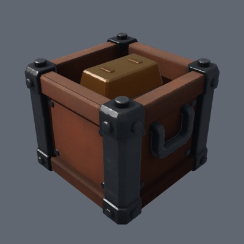</a><b>Stock crate</b>refined, on its way</li>
</ul>

### The ship and the base

<ul class="parts">
  <li><a class="zoom" href="assets/parts/full/ship.jpg">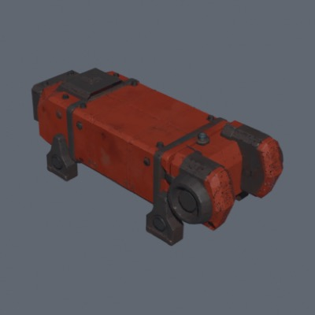</a><b>Your ship</b>you land in it</li>
  <li><a class="zoom" href="assets/parts/full/command.jpg">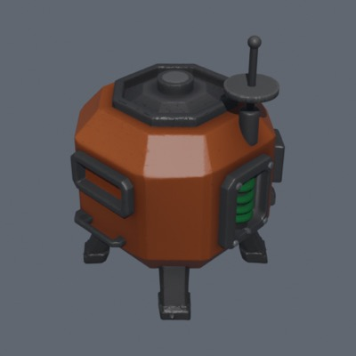</a><b>Command module</b>starts the base</li>
</ul>

### Vaults

<ul class="parts">
  <li><a class="zoom" href="assets/parts/full/vault-gate.jpg">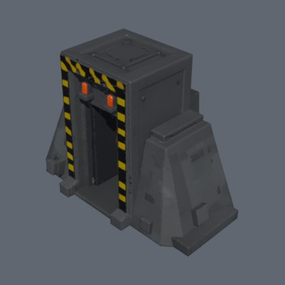</a><b>Bunker gate</b>the way in</li>
  <li><a class="zoom" href="assets/parts/full/vault-door.jpg">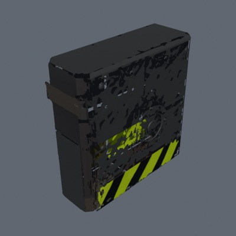</a><b>Blast door</b>what the vault keeps shut</li>
  <li><a class="zoom" href="assets/parts/full/vault-console.jpg">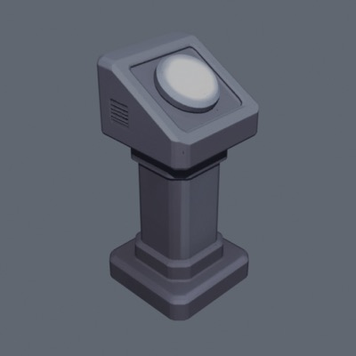</a><b>Console</b>one button of the code</li>
  <li><a class="zoom" href="assets/parts/full/vault-terminal.jpg">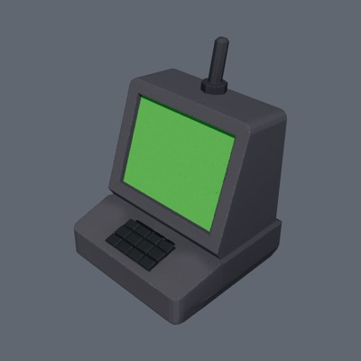</a><b>Terminal</b>a log to read</li>
</ul>

### What hunts you

<ul class="parts">
  <li><a class="zoom" href="assets/parts/full/eyedrone.jpg">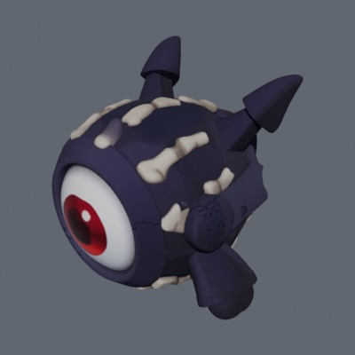</a><b>Eye drone</b></li>
  <li><a class="zoom" href="assets/parts/full/trilobite.jpg">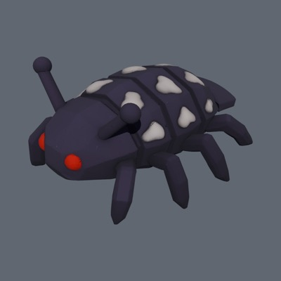</a><b>Trilobite</b></li>
  <li><a class="zoom" href="assets/parts/full/quadshell.jpg">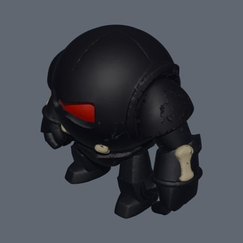</a><b>Quadshell</b></li>
</ul>

### Cover and the land

<ul class="parts">
  <li><a class="zoom" href="assets/parts/full/crate.jpg">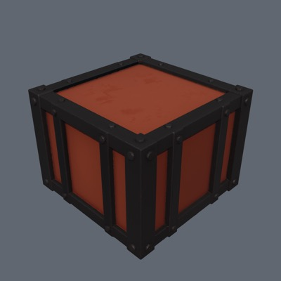</a><b>Crate</b>cover in a fight</li>
  <li><a class="zoom" href="assets/parts/full/column.jpg">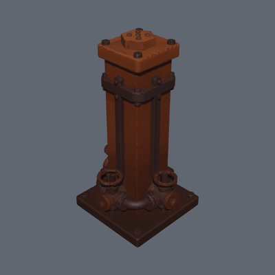</a><b>Pipe column</b>cover in a fight</li>
  <li><a class="zoom" href="assets/parts/full/arch.jpg">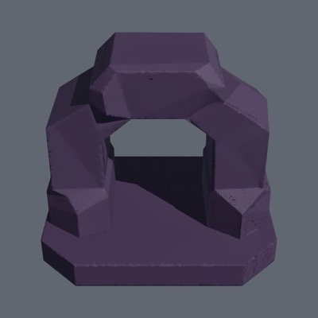</a><b>Arch</b></li>
  <li><a class="zoom" href="assets/parts/full/crystals.jpg">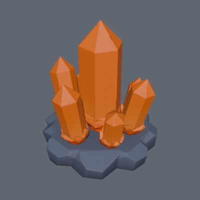</a><b>Crystals</b></li>
  <li><a class="zoom" href="assets/parts/full/fungus.jpg">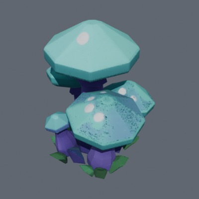</a><b>Fungus</b></li>
  <li><a class="zoom" href="assets/parts/full/vent.jpg">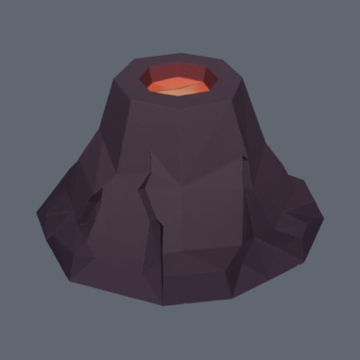</a><b>Vent</b></li>
  <li><a class="zoom" href="assets/parts/full/bones.jpg">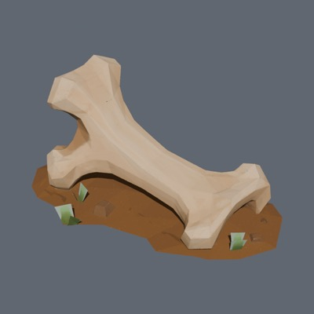</a><b>Bones</b></li>
  <li><a class="zoom" href="assets/parts/full/wreck.jpg">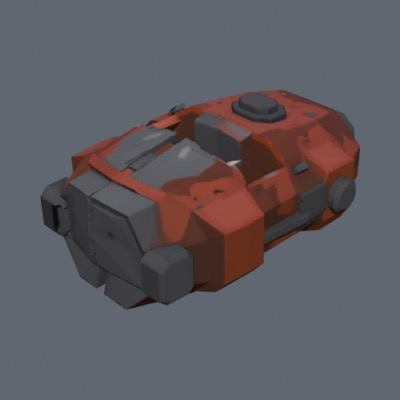</a><b>Wreck</b></li>
</ul>

The game is still in testing. See the [changes](changes.html) for
what each test build added, and the [roadmap](roadmap.html) for what
comes next.
