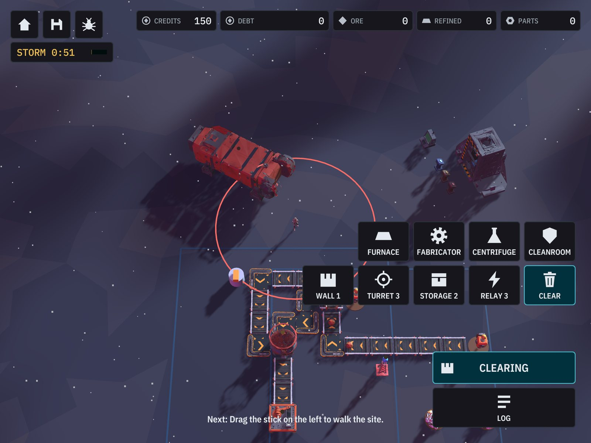

# Stormward

IPAD · IPADOS 26 · FREE

<figure class="shot">
  
  <figcaption>The landing site: ship, shelter ring, belts and the vault.</figcaption>
</figure>

Stormward is a game for iPad. You run outposts on a world the storms
are tearing apart, and you work out who is making the storms.

You mine, lay belts and feed a refiner. When a storm comes, your crew
fights from cover in turns. You trade between colonies and pay off the
Company's debt. The world runs on real ideas, like tariffs, debt and
a carbon price, and the game explains each one where it matters.

## What you need

- An iPad with iPadOS 26 or later.
- No account and no internet. The core game is free.

## Help

Something broken, confusing or unfair? Write to
[stormward@ignoranceisbliss.com](mailto:stormward@ignoranceisbliss.com).
Say which iPad you play on and what you did just before it went wrong.
A screenshot helps a lot.

I read every message. I am one developer, so an answer can take a few
days.

The quickest way: tap the bug key in any screen of the game. It opens
Mail with a picture of the screen already attached.

## Privacy

The game collects nothing about you. The details are on the
[privacy page](privacy.html).

## Credits

Made by Sven Delmas. The models and fonts are free assets by other
people, listed on the [credits page](credits.html).
